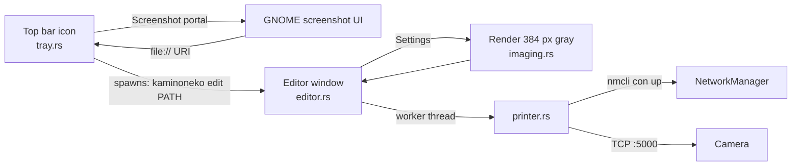

# Kaminoneko

Linux top bar app to take a screenshot, place and scale it on the paper, and print it on a Wi-Fi kids' instant print camera.

> **Status:** progress and priorities are tracked in [PROGRESS.md](PROGRESS.md).

## Overview

Cheap kids' print cameras (Wi-Fi SSID `Children's camera …`, companion app DiDi Cam) have a small
thermal printer, but the only way to print on them is the phone app. Kaminoneko talks to the camera
directly from the PC, using a protocol reverse-engineered from the app's traffic
([docs/PROTOCOL.md](docs/PROTOCOL.md)).

### Features

- Cat icon in the top bar (StatusNotifierItem / AppIndicator).
- Screenshots through the desktop portal: GNOME's own area / window / screen picker, works on Wayland.
- Editor that is just the paper: a to-scale 66 mm strip with a cm ruler and the print length.
  Drag the image to move it, drag a corner (or Ctrl + wheel) to scale it, drag the bottom edge to cut
  the paper; edges snap to the center and the print area.
- Rotation, brightness, contrast, auto contrast, invert colors (turned on automatically for dark
  screenshots), copies. Brutalist controls in light and dark mode.
- Prints over Wi-Fi: switches to the camera's network with NetworkManager, prints and switches back.
- Command-line printing and a `capture` command for a keyboard shortcut.
- Research tools: device probes, capture decoder and a camera simulator.

### Supported

- Linux with NetworkManager and xdg-desktop-portal. Developed on Ubuntu 26.04, GNOME 50, Wayland.
- GNOME needs the AppIndicator extension for the icon (enabled by default on Ubuntu); KDE supports it natively.
- One camera model so far: AppoTech AX3292 based, DiDi Cam app.

## Getting Started

Requirements: `nmcli` (NetworkManager), xdg-desktop-portal (with the GNOME or KDE backend) and
OpenGL or Vulkan. Building needs Rust ≥ 1.89 and no `-dev` system packages. The Python tools need
Python 3 and Pillow.

Install for the current user (binary in `~/.local/bin`, icon and app menu entry):

```bash
# from a release tarball
tar xzf kaminoneko-0.1.0-x86_64-linux.tar.gz
kaminoneko-0.1.0-x86_64-linux/install.sh

# or from the repository (builds with cargo first)
scripts/install.sh

# options: --autostart (start the top bar icon on login), --uninstall
```

Then open **Kaminoneko** from the app menu. Running the install script again updates it.

### Building a release

```bash
scripts/release.sh
# lint (warnings are errors), tests, build, then:
# dist/kaminoneko-<version>-<arch>-linux.tar.gz and its .sha256
```

The tarball holds the binary, `install.sh`, the icon and this README. The binary needs a glibc at
least as new as the build machine's (built on Ubuntu 26.04).

The camera must be on, with its Wi-Fi enabled, and the PC must have connected to its Wi-Fi once
so that NetworkManager has a saved profile for it.

## Usage

### Top bar icon

Open **Kaminoneko** from the app menu: a cat appears in the top bar. Click it and choose
**Take screenshot…** (or **Print an image…** to pick a file). Select the area in GNOME's screenshot
tool and the editor opens.

Opening Kaminoneko again while the cat is in the top bar takes a screenshot instead of adding a
second cat. Right-click the menu entry for **Take screenshot and print** and **Print an image…**
without the top bar icon.

### Editor

The window shows only the paper strip, to scale; every control is in the bar at the bottom.
The hatched sides of the paper are never printed (the head is 384 dots wide).

| On the paper | Does |
|---|---|
| Drag the image | Move it; snaps to the center, the print area edges and the top |
| Drag a corner / Ctrl + wheel | Scale it (keeps the aspect ratio); parts outside the print area are cut |
| Drag the bottom edge | Cut the paper; snaps back to the end of the image |
| Double-click | Fit: full print width, at the top (on the bottom edge: undo the cut) |

- **Size** scales from the bar (10–400 % of the print width); **Fit** and **Center** place it.
- The paper length follows the image and is shown in cm next to the strip.
- **Print** switches to the camera's Wi-Fi, prints and comes back (about 20–30 s without internet).
- **Save PNG** writes `<name>_print.png` next to the original.

### Command line

```bash
kaminoneko               # top bar icon (if already running: take a screenshot)
kaminoneko capture       # take a screenshot and open the editor
kaminoneko open          # pick an image file and open the editor
kaminoneko edit IMAGE    # open the editor with an image
kaminoneko print IMAGE   # print right away at full width, no editor
kaminoneko --version
```

### Keyboard shortcut

GNOME Settings → Keyboard → Custom Shortcuts, command `~/.local/bin/kaminoneko capture`
(full path: GNOME does not always have `~/.local/bin` in its PATH).

### Research tools

| Script | Purpose |
|---|---|
| `tools/probe_device.sh` | First probe of an unknown Wi-Fi device: ports, banners, web, FTP, ESC/POS |
| `tools/probe_camera.py` | RTSP, control channel and FTP checks on the camera (`sudo` also records a pcap) |
| `tools/decode_pcap.py` | Decodes an app traffic capture and rebuilds every printed image |
| `tools/print_image.py` | Minimal Python implementation of the print protocol (images and text) |
| `tools/fake_camera.py` | Camera simulator for testing without hardware |

Every tool writes its output to `captures/`, which is git-ignored.

## Configuration

Environment variables, read when printing:

| Variable | Default | Meaning |
|---|---|---|
| `KAMINONEKO_IP` | `192.168.1.1` | Camera IP |
| `KAMINONEKO_WIFI` | `Children's camera d109` | NetworkManager profile of the camera's Wi-Fi |

When launched from the app menu, set them in the entry's command, e.g.
`Exec=env KAMINONEKO_IP=192.168.1.1 "/home/you/.local/bin/kaminoneko"` in
`~/.local/share/applications/kaminoneko.desktop` (re-running `install.sh` overwrites it).

The network to return to is not configured: it is whichever Wi-Fi was active before printing.
Protocol and paper constants live in `src/printer.rs`: `PAPER_WIDTH_MM` (roll width, 66 mm) and
`DOTS_PER_MM` (print head resolution, used for the preview and the lengths in cm).

## Architecture



1. The tray process (tokio) owns the icon and the portal calls.
2. Each image opens in its own editor process, so the icon never blocks and a closed editor
   cannot take the tray down.
3. The editor renders the print image in three cached stages: tone (rotate → invert → auto contrast →
   brightness / contrast), scale (to the width on the paper) and compose (place it on the 384 px strip,
   cutting whatever falls outside). Moving the image only recomposes; scaling uses a fast filter while
   dragging and Lanczos when released.
4. Printing runs on a worker thread: switch Wi-Fi if the camera is not reachable, run the protocol,
   retry once if the camera answers `1`, then restore the previous Wi-Fi.

## Components

### `src/tray.rs`

StatusNotifierItem icon (`ksni`), screenshot and file chooser portals (`ashpd`), launches editors.

### `src/editor.rs`

`eframe`/`egui` window: to-scale paper with move / scale / cut interactions and snapping, bottom bar
with settings, print and save.

### `src/theme.rs`

Brutalist style for both color modes: square corners, 2 px ink borders, hard shadows, bold monospace
(DejaVu Sans Mono Bold from the system, falling back to egui's Hack) and a yellow accent.

### `src/imaging.rs`

Pure image pipeline from the original screenshot to the 384 px grayscale strip: `Settings` (tone)
and `Placement` (width, position and paper length in dots).

### `src/printer.rs`

Camera protocol (framing, heartbeat, mode, print header, luma conversion) and the Wi-Fi switch.

### `src/main.rs`

Subcommands; a lock in `$XDG_RUNTIME_DIR` keeps a single top bar icon.

### `tools/`

Python and shell tools used to reverse-engineer and test the camera (see [Research tools](#research-tools)).

## Project Structure

```text
kaminoneko/
├── Cargo.toml
├── src/
│   ├── main.rs        # subcommands, single-instance lock
│   ├── tray.rs        # top bar icon, portals
│   ├── editor.rs      # editor window: the paper and its controls
│   ├── theme.rs       # brutalist style
│   ├── imaging.rs     # tone / scale / place pipeline
│   └── printer.rs     # camera protocol, Wi-Fi switching
├── assets/
│   └── kaminoneko.svg # app icon
├── scripts/
│   ├── install.sh     # per-user install: binary, icon, menu entry, autostart
│   └── release.sh     # lint, test, build and package into dist/
├── tools/             # probes, pcap decoder, simulator, Python printer
├── docs/
│   └── PROTOCOL.md    # reverse-engineered print protocol
├── dist/              # release tarballs (git-ignored)
└── captures/          # tool output, pcaps, dumps (git-ignored)
```

## Testing

```bash
# lint, unit tests (pipeline, placement, drag and snap math) and build
cargo clippy --release --all-targets
cargo test --release
cargo build --release

# protocol test without hardware (second terminal for the client)
python3 tools/fake_camera.py --fail-first
KAMINONEKO_IP=127.0.0.1 ./target/release/kaminoneko print some_image.png

# decode a real capture of the app
python3 tools/decode_pcap.py captures/PCAPdroid_xxx.pcap

# save a screenshot of the editor window and exit (UI check); optional placement
# (width,x,y[,length] in dots) and light theme
cargo build --release --features test-screenshot
KAMINONEKO_TEST_SCREENSHOT=/tmp/editor.png ./target/release/kaminoneko edit some_image.png
KAMINONEKO_TEST_PLACEMENT=500,-40,20 KAMINONEKO_TEST_THEME=light \
  KAMINONEKO_TEST_SCREENSHOT=/tmp/editor.png ./target/release/kaminoneko edit some_image.png
```

The simulator saves every print it receives as a PNG in `captures/fake_prints/`.

## Design Principles

- **Copy the app byte for byte.** Unknown protocol fields are sent exactly as the app sends them.
- **Never fuzz the camera.** Blind commands on port 5000 could, for example, format the SD card;
  only commands seen in real captures are sent.
- **Always restore the network.** The Wi-Fi switch is undone even when printing fails.
- **White costs nothing.** Thermal paper only heats dark pixels: keep backgrounds pure white
  (auto contrast runs before resizing; dark screenshots are inverted).
- **No private data in the repo.** Captures hold personal photos and phone traffic and stay in `captures/`.
- **Few system dependencies.** Pure-Rust D-Bus (`zbus`), no GTK or `-dev` packages.

## Additional Notes

- Paper roll: 66 mm wide. The 384 dots are assumed to be 8 dots/mm (≈ 48 mm centered on the roll,
  80 px ≈ 1 cm of paper); not measured on a real print yet.
- A print takes about 11 s once the data is sent.
- The camera's FTP accepts anonymous logins and exposes its firmware; worth knowing before
  connecting it to a shared network.

## Documentation

- [Print protocol](docs/PROTOCOL.md)

## Status & Roadmap

Progress tracking: see [PROGRESS.md](PROGRESS.md).

## License

MIT License

## Contributing

Open an issue or a pull request. For protocol changes, attach a capture decoded with
`tools/decode_pcap.py` (remove personal images first) and test against `tools/fake_camera.py`.
